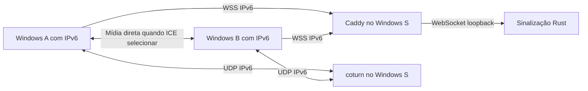

# Roteiro: chamada entre redes via IPv6 público e servidor Windows doméstico

Atualizado em 23/10/2026. Topologia escolhida: **IPv6 público, CGNAT IPv4 e sem VPN**.
Este é um procedimento a executar. Os cinco cenários de aceitação externa permanecem
pendentes; as verificações locais estão em [validação](validacao.md).

[Desenvolvimento](README.md) · [Estudo da infraestrutura](../estudos/infraestrutura/README.md)

O [diagnóstico posterior de 23/10](diagnostico-primeira-chamada.md) registra
serviços em S, a tentativa humana e ensaios sintéticos após correções. Use este
roteiro para preparar ou repetir o ambiente; confira cada condição novamente
antes de executar. O aceite físico completo A/B permanece pendente.

## Objetivo e topologia

- **Windows A:** primeiro participante, em uma rede com IPv6 funcional.
- **Windows B:** segundo participante, em outra rede com IPv6 funcional.
- **Windows S:** terceiro computador doméstico, com IPv6 global atribuído à placa,
  hospedando sinalização Rust, Caddy e coturn nativos.

O roteador observado é um **Technicolor FGA2110**. A investigação informada pelo
responsável identificou WAN IPv4 em espaço CGNAT (100.64.0.0/10), diferente do
IPv4 público observado, IPv6 global não temporário e temporário no Windows S.
Os endereços concretos daquela observação não são configurações permanentes.
O teste informado `curl.exe -6 https://api64.ipify.org` passou, assim como TCP
IPv6 8080. A origem desse teste TCP não foi detalhada; ele não comprova entrada
externa de WSS, UDP, alocação TURN ou transporte de mídia.

O CGNAT IPv4 não é removido por regras no roteador doméstico. Usaremos o IPv6
global do **Windows S**, e não o IPv6 WAN do roteador. Redes somente IPv4 não
conseguirão alcançar esta hospedagem somente IPv6; conferir A e B antes de avançar.

| Serviço no Windows S | Escuta | Permissão de entrada externa |
| --- | --- | --- |
| Sinalização Rust com token | TCP 127.0.0.1:8080 | Nenhuma; acessível pelo Caddy local |
| Caddy com certificado público | TCP 80/443 nas interfaces disponíveis | IPv6 TCP 80 e 443 |
| coturn 4.18.0 nativo | IPv6 global, UDP 3478 | IPv6 UDP 3478 |
| Alocações coturn | Mesmo IPv6 global, UDP 49160–49200 | IPv6 UDP 49160–49200 |



O roteador e o firewall Windows autorizam os fluxos IPv6 destinados ao servidor.
**Não há redirecionamento NAT IPv4 neste procedimento.** Flutter e FFmpeg ficam
nos participantes; Rust mantém a autoridade sobre sinalização, ICE, DTLS/SRTP
e mídia. O servidor não abre câmera ou microfone.

## 1. Conferir IPv6 nas três máquinas

### 1.1. Windows S: localizar a interface e o endereço para hospedagem

Em PowerShell, sem VPN:

```powershell
Get-NetConnectionProfile
Get-NetIPConfiguration
Get-NetIPAddress -AddressFamily IPv6 | Format-Table InterfaceAlias,IPAddress,AddressState,PrefixOrigin,SuffixOrigin,PreferredLifetime,ValidLifetime -AutoSize
Get-NetRoute -AddressFamily IPv6 -DestinationPrefix '::/0'
netsh interface ipv6 show addresses
ipconfig /all
curl.exe -6 https://api64.ipify.org
```

Escolher na placa Wi-Fi/Ethernet ativa um endereço global, em estado `Preferred`,
identificado como público/não temporário na listagem do Windows. `2000::/3` é
o espaço global unicast usado neste cenário. Excluir loopback `::1`, link-local
`fe80::/10` e ULA `fc00::/7`. Não usar interfaces VPN, virtuais ou desconectadas.
Não confundir `SuffixOrigin=Random` com prova de endereço temporário: verificar
a classificação da listagem do `netsh` e os tempos de vida também.

O `curl -6` pode mostrar o endereço **temporário de saída**. Não copiá-lo
automaticamente para AAAA ou TURN. O endereço escolhido precisa estar atribuído
a S e continuar válido; não desabilitar a privacidade IPv6 do Windows para isso.
Não fixar um endereço de um prefixo que o provedor já retirou.

Guardar o endereço escolhido para os comandos deste terminal, sem colchetes:

```powershell
$ipv6Servidor = Read-Host 'IPv6 global nao temporario atual do Windows S'
$ipConferido = [System.Net.IPAddress]::Parse($ipv6Servidor)
if ($ipConferido.AddressFamily -ne [System.Net.Sockets.AddressFamily]::InterNetworkV6) { throw 'Informe IPv6.' }
Get-NetIPAddress -AddressFamily IPv6 -IPAddress $ipv6Servidor -ErrorAction Stop
```

A conferência acima valida atribuição, não alcance público. Guardar interface,
data e tempos de vida em registro privado. Endereço não temporário também pode
mudar com prefixo delegado, troca de placa, reinstalação ou reconexão.

### 1.2. Windows A e B: conferir cada rede de acesso

Executar separadamente nos dois participantes:

```powershell
Get-NetIPAddress -AddressFamily IPv6
Get-NetRoute -AddressFamily IPv6 -DestinationPrefix '::/0'
curl.exe -6 https://api64.ipify.org
```

É necessário um caminho IPv6 real, não somente `fe80::` na placa. O teste de
saída é uma pré-condição; depois testar o domínio de S e a mídia. Hotspots e
operadoras podem oferecer IPv6 ao telefone e não ao computador conectado a ele.
Se falhar, corrigir a rede ou escolher outra com IPv6 antes deste ensaio. Esta
implantação não oferece acesso aos participantes exclusivamente IPv4; não há
fallback público IPv4 através do CGNAT nem TURN TCP/TLS nesta integração.

**Resultado para avançar:** S possui IPv6 global de hospedagem e A/B possuem
saída IPv6 nas redes diferentes que serão usadas.

## 2. Preparar o Windows S

Conferir Windows x64, relógio, energia, conexão estável e portas livres:

```powershell
Get-NetTCPConnection -State Listen
Get-NetUDPEndpoint
New-Item -ItemType Directory -Force C:/POC_Servidor/bin
New-Item -ItemType Directory -Force C:/POC_Servidor/conf
New-Item -ItemType Directory -Force C:/POC_Servidor/segredos
New-Item -ItemType Directory -Force C:/POC_Servidor/logs
New-Item -ItemType Directory -Force C:/POC_Servidor/coturn/bin
```

Usar uma conta de operação definida. Restringir leitura de segredos e do arquivo
TURN à conta e administradores necessários nas propriedades de Segurança.
Impedir suspensão/hibernação durante a hospedagem, inclusive ao fechar tampa.
O monitor pode desligar. Preferir cabo, quando disponível.

Não é necessário reservar IPv4 LAN para receber IPv6. Uma reserva DHCPv4 pode
continuar útil à administração local, mas não fixa o prefixo IPv6. O perfil
Público/Privado do firewall Windows é confiança da rede, não família de endereço
nem indicação de IP público.

## 3. Preparar DNS AAAA e Caddy

### 3.1. Nome público

Usar domínio sob seu controle, como `chamada.exemplo.org` (ilustrativo).
Criar **AAAA** com o IPv6 global não temporário atual de S, sem `https://`,
porta, colchetes ou tamanho de prefixo. Neste desenho, não publicar registro A
para o IPv4 CGNAT ou para o IPv4 público de saída sem entrada correspondente.
Remover A/AAAA antigos que encaminhem o mesmo nome a outro servidor.

Usar resolução DNS direta, sem proxy HTTP/CDN no registro. TURN UDP não passa
pelo proxy HTTP do Caddy nem por um proxy HTTP comum do provedor DNS.

```powershell
$dominio = Read-Host 'Dominio real da chamada'
Resolve-DnsName $dominio -Type AAAA
```

Repetir de A e B depois do TTL. O resultado deve corresponder ao endereço de S
que ainda está atribuído à placa. DNS não verifica se as portas estão abertas.

### 3.2. Mudanças de prefixo e DNS dinâmico

Para o primeiro teste, atualização manual é suficiente. Depois, usar o recurso
AAAA de um provedor DNS/DDNS e seu cliente oficial/documentado. Configurar o
cliente para selecionar o endereço de hospedagem da interface de S; um atualizador
que use apenas o endereço visto por `curl` pode publicar o temporário errado.
Um DDNS executado no roteador pode publicar o endereço do roteador em vez de S.

Ao mudar o endereço: pausar o ensaio, atualizar AAAA, `listening-ip`/`relay-ip`
do coturn, regras vinculadas ao endereço em Windows/roteador e reiniciar coturn.
Conferir propagação e repetir testes externos. Caddy usa escuta wildcard e o
certificado é do nome; não exige nova emissão só por mudar o IP. Conexões em
andamento não migram automaticamente. O projeto não implementa um atualizador próprio.

### 3.3. Executável Caddy

Baixar Windows x64 no [site oficial](https://caddyserver.com/docs/install#static-binaries)
e colocar em `C:/POC_Servidor/bin/caddy.exe`:

```powershell
& 'C:/POC_Servidor/bin/caddy.exe' version
```

O certificado será emitido após liberar entradas. Preservar armazenamento de
certificados gravável e persistente e usar sempre a mesma conta de operação.

## 4. Colocar a sinalização Rust no Windows S

### 4.1. Produzir o executável

Na máquina Windows de desenvolvimento com Rust e ferramentas MSVC já preparados,
na raiz do repositório:

```powershell
cargo build --locked -p sinalizacao --release
cargo test --locked -p sinalizacao
```

Copiar `target/release/sinalizacao.exe` para o Windows S:

`C:\POC_Servidor\bin\sinalizacao.exe`

A compilação pode ser feita no próprio Windows S se ele receber a toolchain,
mas ela não é necessária ali quando o executável é produzido em outro Windows
compatível.

Se faltar runtime Microsoft ao abrir o pacote, instalar o
[Visual C++ Redistributable oficial](https://learn.microsoft.com/en-us/cpp/windows/latest-supported-vc-redist)
da arquitetura correspondente. Não obter DLLs isoladas em sites de terceiros.

### 4.2. Criar o token no Windows S

Em PowerShell, gerar 32 bytes aleatórios e guardar o resultado:

```powershell
$bytesToken = New-Object byte[] 32
$geradorToken = [System.Security.Cryptography.RandomNumberGenerator]::Create()
$geradorToken.GetBytes($bytesToken)
[Convert]::ToBase64String($bytesToken) | Set-Content -LiteralPath 'C:\POC_Servidor\segredos\token-sinalizacao.txt' -Encoding ascii
$geradorToken.Dispose()
```

Gerar uma única vez para esta implantação. Executar novamente substitui o token
e exige atualizar os clientes. Guardar a credencial de forma privada; não
versioná-la no Git ou incluí-la em URLs.

### 4.3. Iniciar manualmente para a primeira verificação

Em um PowerShell que permanecerá aberto:

```powershell
$env:SINALIZACAO_TOKEN = (Get-Content -Raw -LiteralPath 'C:\POC_Servidor\segredos\token-sinalizacao.txt').Trim()
& 'C:\POC_Servidor\bin\sinalizacao.exe' '127.0.0.1:8080'
```

Em outro PowerShell:

```powershell
Get-NetTCPConnection -State Listen -LocalPort 8080
```

Conferir que o endereço de escuta é `127.0.0.1` e que a mensagem de início
indica acesso por token.

### O que estará acontecendo

O servidor recebe o token pelo ambiente do próprio processo. Ele confere essa
chave na mensagem de entrada antes de permitir a sala.

O backend só aceita conexões dentro do Windows S. O Caddy, instalado na mesma
máquina, poderá falar com ele. Os participantes não precisarão acessar TCP 8080.

A sinalização encaminha a negociação entre duas pessoas; ela não captura nem
retransmite seus pacotes de câmera/microfone.

**Resultado para avançar:** sinalização ativa em loopback, protegida pelo token.

## 5. Preparar coturn nativo Windows com IPv6 global

### 5.1. Entender de onde virá o pacote

O projeto coturn lista Windows nativo e mantém compilação MSVC. O procedimento
abaixo toma a versão 4.18.0 como referência reproduzível. Não presume que exista
um instalador Windows em toda página de release.

A compilação pode ser feita no Windows de desenvolvimento. Depois, copiar o
pacote para o Windows S. Se optar por compilar no próprio servidor, ele precisará
das ferramentas desta seção. Não é necessário instalar ferramentas de compilação
nos dois participantes.

### 5.2. Preparar as ferramentas de compilação

Na máquina que compilará coturn, instalar:

1. Git para Windows.
2. Visual Studio ou Build Tools 2022 com ferramentas C++ de desktop,
   toolset MSVC v143 e Windows SDK.
3. CMake, incluindo acesso pelo terminal.

O exemplo fixa o gerador Visual Studio 2022. Se a máquina usar outra versão,
adaptar gerador/toolset de forma compatível, sem misturar bibliotecas de
arquiteturas diferentes. A instalação do suporte C++ está na
[documentação da Microsoft](https://learn.microsoft.com/en-us/cpp/build/vscpp-step-0-installation).

Abrir o Developer PowerShell correspondente e conferir:

```powershell
git --version
cmake --version
cl
```

O comando `cl` deve identificar o compilador MSVC; executá-lo sem fontes pode
encerrar com uma mensagem de uso, o que não significa que ele esteja ausente.

### 5.3. Obter fontes e dependências fixadas

Em uma pasta nova para estas dependências:

```powershell
New-Item -ItemType Directory -Force C:\POC_Fontes
git clone --branch 4.18.0 --depth 1 https://github.com/coturn/coturn.git C:\POC_Fontes\coturn
git clone https://github.com/microsoft/vcpkg.git C:\POC_Fontes\vcpkg
git -C C:\POC_Fontes\vcpkg checkout dd3097e305afa53f7b4312371f62058d2e665320
& 'C:\POC_Fontes\vcpkg\bootstrap-vcpkg.bat'
```

Esse commit do vcpkg é o indicado pelo workflow MSVC da versão de referência.
O uso de manifesto e toolchain permite que o CMake solicite as dependências.
A preparação do vcpkg está descrita pela
[Microsoft](https://learn.microsoft.com/en-us/vcpkg/get_started/get-started-msbuild).

Esses clones são de ferramentas públicas, fora do repositório da POC. Eles não
publicam o código deste projeto.

### 5.4. Configurar e compilar

No Developer PowerShell, usar uma lista de argumentos para evitar linhas
muito longas:

```powershell
$argumentosCoturn = @(
    '-S', 'C:/POC_Fontes/coturn',
    '-B', 'C:/POC_Fontes/coturn/build',
    '-G', 'Visual Studio 17 2022',
    '-A', 'x64',
    '-T', 'v143',
    '-DWITH_MYSQL=OFF',
    '-DBUILD_SHARED_LIBS=OFF',
    '-DCMAKE_BUILD_TYPE=Release',
    '-DVCPKG_TARGET_TRIPLET=x64-windows',
    '-DVCPKG_INSTALLED_DIR=C:/POC_Fontes/dependencias-coturn',
    '-DCMAKE_TOOLCHAIN_FILE=C:/POC_Fontes/vcpkg/scripts/buildsystems/vcpkg.cmake'
)
cmake @argumentosCoturn
cmake --build C:/POC_Fontes/coturn/build --config Release
```

Continuar somente se configuração e compilação terminarem com sucesso. O vcpkg
pode baixar e compilar várias dependências; esta etapa precisa de acesso aos
respectivos repositórios.

**O que acontece:** o compilador gera o servidor TURN como aplicativo Windows.
Embora `BUILD_SHARED_LIBS=OFF` selecione bibliotecas próprias estáticas, ainda
podem existir DLLs das dependências do triplet Windows.

### 5.5. Montar e transferir o pacote

Localizar `turnserver.exe` em `C:\POC_Fontes\coturn\build\bin\Release`.
Copiar todo o conteúdo dessa pasta para `C:\POC_Servidor\coturn\bin`.
Levar também as DLLs de runtime de
`C:\POC_Fontes\dependencias-coturn\x64-windows\bin` que o pacote utilizar.
Preservar as licenças do coturn e das dependências distribuídas.

Se o build produzir outra organização de saída, localizar os executáveis reais
antes de copiar. Não considerar apenas a existência do arquivo como teste de
execução. No Windows S, conferir:

```powershell
& 'C:\POC_Servidor\coturn\bin\turnserver.exe' --version
& 'C:\POC_Servidor\coturn\bin\turnserver.exe' --help
```

Se houver erro de DLL ou arquitetura, corrigir o pacote antes de investigar
roteador. Os comandos de build foram derivados do fluxo upstream; não foram
executados neste trabalho de documentação.

### 5.6. Configuração IPv6 e família das alocações

Copiar [o exemplo do projeto](../../config/turnserver-ipv6.exemplo.conf) para
`C:/POC_Servidor/conf/turnserver.conf` e editar **fora do Git**. Seu núcleo é:

```ini
listening-port=3478
listening-ip=IPV6_GLOBAL_DO_WINDOWS_S
relay-ip=IPV6_GLOBAL_DO_WINDOWS_S
allocation-default-address-family=ipv6
fingerprint
lt-cred-mech
realm=chamada-poc
user=USUARIO_TURN:SENHA_ALEATORIA_TURN
min-port=49160
max-port=49200
user-quota=8
total-quota=16
no-tcp
no-tls
no-tcp-relay
no-multicast-peers
log-file=stdout
```

Preencher IPv6 numérico realmente atribuído a S, sem colchetes, em ambas as
linhas. Não usar hostname ou `::` como endereço relay específico. **Remover
`external-ip`**: este IPv6 global não precisa de mapeamento público/privado.
O coturn deverá devolver esse mesmo IPv6 em `XOR-RELAYED-ADDRESS`, com uma porta
da faixa. Não reutilizar o IPv4 privado da configuração NAT anterior.

**Detalhe necessário nesta versão do cliente:** `rtc-turn 0.21.1` não envia
`REQUESTED-ADDRESS-FAMILY` nas duas mensagens Allocate. O padrão TURN é alocar
IPv4 mesmo se o pedido chega em IPv6. Para este serviço dedicado à PoC IPv6,
`allocation-default-address-family=ipv6` muda explicitamente esse padrão.
A opção existe no [parser e help do coturn 4.18.0](https://github.com/coturn/coturn/blob/4.18.0/src/apps/relay/mainrelay.c).
Um pedido explícito de outra família tem precedência. Essa configuração é uma
compatibilidade deste cenário, não uma afirmação de que o cliente solicita
IPv6 conforme RFC 6156. Evita alterar ou copiar a biblioteca inteira.

O exemplo completo também nega destinos privados, compartilhados, loopback,
ULA e link-local, usando intervalos. Preservar essas linhas. Revisar também
destinos internos com endereços globais da residência: se negar seu prefixo
LAN, permitir especificamente o IPv6 relay de S com `allowed-peer-ip`, pois
os dois participantes usarão alocações nesse mesmo endereço. Uma negação
indiscriminada do IPv6 de S quebra relay↔relay. Não habilitar `allow-loopback-peers`,
`server-relay`, `no-auth`, CLI ou administração web no serviço público.
A sintaxe de filtros, escuta e quotas está no [exemplo oficial fixado](https://github.com/coturn/coturn/blob/4.18.0/examples/etc/turnserver.conf).

Gerar senha TURN aleatória, diferente do token de sinalização, pelo mesmo método
criptográfico da seção 4 e guardar em arquivo privado. `user-quota=8` vale por
usuário e `total-quota=16` para o serviço. Cada interface/endereço local do cliente
pode criar uma alocação: excesso de adaptadores pode esgotar quotas (erro 486/508).
Conferir logs e interfaces de teste antes de elevar limites, mantendo-os finitos.

Não copiar `keep-address-family` de exemplos antigos: usar a opção explícita
acima. A configuração não habilita DTLS nem TLS de TURN. CLI/DTLS não são ativados
por padrão em 4.18.0; não acrescentar as opções antigas `no-cli`/`no-dtls`.

### 5.7. Iniciar e conferir sockets

Em PowerShell separado, com sinalização ainda ativa:

```powershell
Set-Location C:/POC_Servidor/coturn/bin
./turnserver.exe -c C:/POC_Servidor/conf/turnserver.conf
```

Em outra janela:

```powershell
Get-NetUDPEndpoint -LocalPort 3478
```

Conferir IPv6 correto, versão, ausência de erro de bind/configuração e credenciais
ativas. As portas 49160–49200 são abertas conforme alocações surgem; não precisam
estar todas ocupadas antes de uma sessão. Guardar logs privados do ensaio.

**Resultado para avançar:** executável TURN inicia em S com UDP IPv6 e
alocações configuradas para IPv6; alcance e mídia ainda não estão comprovados.

## 6. Autorizar entrada IPv6 no Windows S e no roteador

### 6.1. Firewall Windows S — execução manual como administrador

Conferir regras existentes para evitar duplicatas e o perfil real:

```powershell
Get-NetConnectionProfile
Get-NetFirewallRule -DisplayName 'POC*' -ErrorAction SilentlyContinue
```

No terminal administrativo, definir o IPv6 novamente (variáveis não passam de
um terminal a outro). O exemplo usa perfil `Private` para rede doméstica
confiável; adaptar ao perfil real, sem alterar confiança só para fazer o teste:

```powershell
$ipv6Servidor = Read-Host 'IPv6 global atual do Windows S'
New-NetFirewallRule -DisplayName 'POC Caddy IPv6 HTTP HTTPS' -Direction Inbound -Action Allow -Protocol TCP -LocalPort 80,443 -LocalAddress $ipv6Servidor -Program 'C:/POC_Servidor/bin/caddy.exe' -Profile Private
New-NetFirewallRule -DisplayName 'POC coturn IPv6 entrada UDP' -Direction Inbound -Action Allow -Protocol UDP -LocalPort 3478 -LocalAddress $ipv6Servidor -Program 'C:/POC_Servidor/coturn/bin/turnserver.exe' -Profile Private
New-NetFirewallRule -DisplayName 'POC coturn IPv6 relay UDP' -Direction Inbound -Action Allow -Protocol UDP -LocalPort 49160-49200 -LocalAddress $ipv6Servidor -Program 'C:/POC_Servidor/coturn/bin/turnserver.exe' -Profile Private
```

Consultar a [sintaxe oficial](https://learn.microsoft.com/en-us/powershell/module/netsecurity/new-netfirewallrule).
Essas regras ficam vinculadas ao endereço e executável atuais. Atualizá-las
se algum mudar; não acumular regras antigas. Exemplo de atualização do endereço:

```powershell
Get-NetFirewallRule -DisplayName 'POC Caddy IPv6 HTTP HTTPS','POC coturn IPv6 entrada UDP','POC coturn IPv6 relay UDP' | Get-NetFirewallAddressFilter | Set-NetFirewallAddressFilter -LocalAddress $ipv6Servidor
```

Não criar entrada externa para TCP 8080. Backend e eventual administração do
Caddy permanecem locais. Se outro produto filtrar rede, revisar sua política.
Preservar o funcionamento de ICMPv6 necessário à rede e descoberta de MTU; não
criar bloqueio geral de ICMPv6 como parte deste procedimento.

### 6.2. Technicolor FGA2110 — permissões de entrada, sem NAT

A versão de firmware/painel da operadora não foi inspecionada e não foi localizada
uma referência oficial específica que confirme seus menus. **Não presumir que
há uma tela ou função com determinado nome.** No painel autorizado, procurar
controles de firewall IPv6, regras de entrada ou pinholes e registrar o firmware.
Quando disponíveis, criar permissões WAN→LAN com destino **IPv6 de S**:

| Permissão | Família/protocolo | Destino | Porta de destino |
| --- | --- | --- | --- |
| HTTP/ACME | IPv6 TCP | IPv6 global de S | 80 |
| HTTPS/WSS | IPv6 TCP | IPv6 global de S | 443 |
| TURN/STUN | IPv6 UDP | IPv6 global de S | 3478 |
| Mídia relay | IPv6 UDP | IPv6 global de S | 49160–49200 |

Não restringir porta de origem do cliente a 3478: clientes usam portas efêmeras.
Para ACME, a origem precisa admitir validadores públicos; para TURN considerar
os dois clientes e seus endereços possivelmente dinâmicos. Manter política
stateful e demais restrições existentes. Registrar regras e alterações feitas.

IPv6 entrega o pacote diretamente a S; não configurar tradução de porta nem
apontar estas regras ao IPv4 privado. A tela Port Forwarding/NAT IPv4 não resolve
a autorização IPv6. Não liberar RDP/painel administrativo, desabilitar o firewall
inteiro ou colocar S em DMZ. Se o firmware não permitir regra específica ou a
operadora bloquear entrada IPv6, isso é uma pendência real a resolver com ela;
não há garantia de que apenas possuir endereço global seja suficiente.

### 6.3. Participantes

A/B precisam permitir saída UDP para S:3478 e para candidatos/portas negociados.
Permitir entrada UDP do executável do aplicativo no perfil efetivamente usado,
conforme a política da rede, para os sockets ICE em portas efêmeras. Não liberar
os helpers FFmpeg para acesso externo: continuam em loopback. Não se exige
Port Forwarding IPv4 nos participantes. Redefinir o caminho do executável em
regras quando distribuir uma nova pasta.

**Resultado para avançar:** permissões específicas aplicadas manualmente nos
dois firewalls de entrada de S; serviços precisam continuar ativos.

## 7. Ativar WSS e testar externamente por IPv6

### 7.1. Arquivo Caddy e certificado público

Copiar [Caddyfile de exemplo](../../config/Caddyfile.exemplo) para
`C:/POC_Servidor/conf/Caddyfile` e trocar o domínio:

```caddyfile
chamada.exemplo.org {
    reverse_proxy 127.0.0.1:8080
}
```

Caddy escuta wildcard por padrão, inclusive o caminho IPv6 disponível; não usar
`bind 127.0.0.1` para a entrada pública. O upstream IPv4 loopback está correto:
Caddy e Rust estão na mesma máquina. O proxy já suporta upgrade WebSocket.
A configuração mínima não requer um endereço IPv6 fixo dentro do Caddyfile.
Ver [bind](https://caddyserver.com/docs/caddyfile/directives/bind).

```powershell
& 'C:/POC_Servidor/bin/caddy.exe' validate --config 'C:/POC_Servidor/conf/Caddyfile' --adapter caddyfile
& 'C:/POC_Servidor/bin/caddy.exe' run --config 'C:/POC_Servidor/conf/Caddyfile' --adapter caddyfile
```

Conferir logs de certificado e sockets em outro terminal:

```powershell
Get-NetTCPConnection -State Listen -LocalPort 80,443,8080
```

Confirmar entrada IPv6 TCP 80/443 e 8080 somente em `127.0.0.1`. O HTTPS
automático usa o domínio e suas entradas DNS para obter/renovar certificado.
AAAA correto e alcance dos validadores por IPv6 são necessários; HTTP-01 usa
TCP 80 e TLS-ALPN-01 TCP 443. Não precisa publicar um A artificial. Se entrada
80 for bloqueada, TLS-ALPN-01 em 443 pode ser uma alternativa, a comprovar nos
logs; DNS-01 exige integração do provedor e não abre WSS/TURN por si só.
Ver [ACME no Caddy](https://caddyserver.com/docs/automatic-https) e
[IPv6 no Let's Encrypt](https://letsencrypt.org/docs/ipv6-support/).

Não usar `tls internal`, certificados inseguros, ignorar erro TLS ou instalar
raiz interna nos participantes. Conferir relógio, armazenamento persistente e
conta de operação para renovação.

### 7.2. Windows A e B, cada um em sua rede externa

```powershell
$dominio = Read-Host 'Dominio real da chamada'
Resolve-DnsName $dominio -Type AAAA
$destinosV6 = Resolve-DnsName $dominio -Type AAAA | Where-Object Type -eq 'AAAA'
$destinosV6 | ForEach-Object { Test-NetConnection -ComputerName $_.IPAddress -Port 443 -InformationLevel Detailed }
curl.exe -6 -v -I "https://$dominio"
```

Conferir `RemoteAddress` IPv6, certificado para o nome e ausência de falha TLS.
HTTP 400/426 pode ser do backend por falta de upgrade WebSocket. Sucesso de
TLS/HTTP é um passo anterior à entrada autenticada na sala. Não usar `-k`.
Pode testar TCP 80 da mesma forma para HTTP/ACME, sem inferir nada sobre UDP.

Repetir do próprio S só como diagnóstico adicional. O teste decisivo é a partir
de A e B externos. Reflexão NAT IPv4 não é requisito deste caminho IPv6; se
apenas o acesso interno falhar, verificar DNS local, roteamento e firewalls.

**Resultado para avançar:** ambos alcançam o domínio por IPv6 com TLS público
válido. A abertura WSS e a sala ainda serão conferidas no aplicativo.

## 8. Preparar os participantes

### 8.1. Compilar e distribuir

Na máquina de desenvolvimento Windows, na raiz do checkout:

```powershell
flutter --version
flutter doctor -v
flutter devices
./scripts/preparar-midia.ps1
Push-Location app
flutter pub get
flutter analyze
flutter build windows --release
Pop-Location
```

Distribuir **toda** a pasta `app/build/windows/x64/runner/Release/`, incluindo
DLLs, `data/`, FFmpeg, FFplay e licenças. Se necessário instalar o runtime
[Visual C++ oficial](https://learn.microsoft.com/en-us/cpp/windows/latest-supported-vc-redist).
Os participantes não precisam de Rust, coturn ou Caddy. Conferir câmera/microfone,
saída de áudio e regras do aplicativo. Usar fones.

### 8.2. Arquivo local e endpoint WSS

Copiar `config/cliente.exemplo.json` para `C:/POC_Chamada/cliente.json` em A e B,
fora do Git. Preencher o nome DNS real com AAAA e segredos correspondentes:

```json
{
  "token_sinalizacao": "TOKEN_REAL_DA_SINALIZACAO",
  "servidores_ice": [
    {
      "urls": [
        "stun:chamada.exemplo.org:3478",
        "turn:chamada.exemplo.org:3478?transport=udp"
      ],
      "usuario": "USUARIO_REAL_TURN",
      "senha": "SENHA_REAL_TURN"
    }
  ],
  "somente_retransmissao": false
}
```

O formato existente foi mantido. O runtime ICE resolve DNS e seleciona endereço
da mesma família do socket local; o cliente agora abre IPv4 **e IPv6**. Um hostname
AAAA funciona para STUN e TURN. Nesta biblioteca, TURN com IPv6 literal tem erro
ao reconstruir `host:porta`; o cliente o rejeita antecipadamente e orienta usar
hostname AAAA. STUN literal com colchetes e WSS IPv6 são aceitos pelo parser;
WSS continua precisando de certificado válido para o nome/endereço acessado.
Preferir o domínio em todos os campos deste ensaio.

Abrir em **cada** participante pelo mesmo PowerShell que define a variável:

```powershell
$env:CHAMADA_CONFIG = 'C:/POC_Chamada/cliente.json'
& 'C:/POC_Chamada/Release/poc_chamada.exe'
```

Na interface, servidor `wss://chamada.exemplo.org` com o domínio real e mesma
sala nos dois lados. O endpoint não fica dentro do JSON. Sem `CHAMADA_CONFIG`,
permanece a LAN sem exigir STUN/TURN. O arquivo é lido a cada entrada na sala;
não é descoberto automaticamente pela pasta do executável.

### 8.3. Validar autorização

Entrar com token correto; conferir que o primeiro aguarda e o segundo permite
negociação. Encerrar ambos. Testar token incorreto em um cliente e conferir
rejeição; restaurar o correto. Não registrar os valores secretos nos resultados.

## 9. Executar os cinco cenários de aceitação

Registrar horários, versões, pacote/commit e redes. **Todos seguem pendentes até
execução física.** O estado Connected, isoladamente, não comprova áudio/vídeo.

### Cenário 1 — WSS por IPv6

A/B em redes diferentes entram na mesma sala pelo domínio AAAA com certificado
público e token válido. Confirmar IP remoto IPv6 nos testes e conexões do servidor.
Não contar um simples `Test-NetConnection` como conclusão deste cenário.

### Cenário 2 — ICE normal

Com `somente_retransmissao: false` nos dois JSONs, entrar, observar vídeo remoto
e conversar nos dois sentidos. O texto `Caminho ICE` mostra o **par selecionado**,
com tipo, protocolo, família, IP e porta locais/remotos. Registrar ambos os lados,
por exemplo `host udp IPv6 [endereço]:porta`. A seleção normal pode ser direta
ou retransmitida, IPv4 ou IPv6 entre participantes; WSS/serviço TURN continuam IPv6.
Para afirmar que mídia direta IPv6 passou, o par correspondente precisa indicar IPv6.

### Cenário 3 — TURN forçado

Encerrar, editar os dois JSONs para `somente_retransmissao: true` e entrar de novo.
É possível fechar/reabrir os aplicativos para tornar a configuração do ensaio
inequívoca. Exigir `relay` **local e remoto em ambos os participantes**, com
IPv6 de S e portas dentro de 49160–49200. Se mostrar apenas host/srflx, o ensaio
não está usando a política/configuração esperada.

No coturn, relacionar as alocações autenticadas e seus endereços relay ao horário
e aos pares exibidos. Conferir contadores de pacotes/bytes enviados e recebidos
crescendo (relatórios de uso/logs da sessão; `verbose` temporário pode ajudar)
e tráfego UDP durante fala/movimento. Juntar essa evidência com vídeo remoto
visível e fala audível nos dois sentidos. Captura de pacotes no servidor, se
necessária, deve mostrar UDP 3478 e os endpoints relay; guardar a captura fora
do Git. Não é preciso descriptografar SRTP para identificar o caminho UDP.

Uma alocação só comprova Allocate. A seleção relay comprova o caminho ICE;
a recepção efetiva da mídia comprova que esse caminho transporta a chamada.
As duas alocações usam o IPv6 global de S sem exigir hairpin NAT IPv4. Conferir
filtros de peers que possam bloquear o próprio IPv6 relay.

### Cenário 4 — estabilidade

Após a mídia estar funcional, medir **pelo menos cinco minutos no modo normal
e cinco minutos no TURN forçado**, separadamente. Confirmar áudio/vídeo contínuos
nos dois sentidos, pausas, perda aparente, consumo e upload de S no modo relay.
Não usar tempo aguardando sala/negociação para completar os cinco minutos.

### Cenário 5 — encerramento e nova chamada

Em cada modo, encerrar, conferir câmera/microfone liberados e fazer nova chamada
com ambos entrando novamente na sala. Não reiniciar Rust/Caddy/coturn entre as
chamadas. Não há reconexão automática nesta PoC; é uma nova entrada manual.
Restaurar `false` nos JSONs ao terminar o ensaio TURN.

### Limites reais

A integração só usa STUN/TURN UDP. `turns:` e `transport=tcp` são rejeitados;
WSS pode funcionar numa rede que bloqueia a mídia UDP. A configuração de família
no coturn é necessária ao cliente fixado. Este servidor somente IPv6 não atende
redes apenas IPv4. Não há garantia de entradas permitidas no firmware/provedor
sem os testes externos. Build e testes locais não eliminam esses limites.

## 10. Operação, manutenção e diagnóstico

### 10.1. Primeira operação: três processos visíveis

Na primeira validação, manter três terminais abertos no Windows S: sinalização,
Caddy e coturn. Isso facilita relacionar tentativas e mensagens. Fechar esses
terminais pode encerrar os processos correspondentes.

Conferir consumo, estabilidade e tráfego de upload durante o ensaio TURN.
Nesse modo, a conexão residencial do terceiro PC participa do transporte da
mídia nos dois sentidos. Não há medição de capacidade deste ambiente ainda.

### 10.2. Preparar reinício automático depois de validar manualmente

Criar três arquivos locais de inicialização. Eles são exemplos para salvar no
Windows S; não são scripts adicionados ao repositório por este trabalho.

Em `C:\POC_Servidor\iniciar-sinalizacao.ps1`:

```powershell
$ErrorActionPreference = 'Stop'
$env:SINALIZACAO_TOKEN = (Get-Content -Raw -LiteralPath 'C:\POC_Servidor\segredos\token-sinalizacao.txt').Trim()
if ([string]::IsNullOrWhiteSpace($env:SINALIZACAO_TOKEN)) {
    throw 'Token de sinalizacao vazio.'
}
Set-Location C:\POC_Servidor
& '.\bin\sinalizacao.exe' '127.0.0.1:8080' 2>&1 | Tee-Object -FilePath '.\logs\sinalizacao.log' -Append
```

Em `C:\POC_Servidor\iniciar-caddy.ps1`:

```powershell
Set-Location C:\POC_Servidor
& '.\bin\caddy.exe' run --config '.\conf\Caddyfile' --adapter caddyfile 2>&1 | Tee-Object -FilePath '.\logs\caddy.log' -Append
```

Em `C:\POC_Servidor\iniciar-turn.ps1`:

```powershell
Set-Location C:\POC_Servidor\coturn\bin
& '.\turnserver.exe' -c C:/POC_Servidor/conf/turnserver.conf 2>&1 | Tee-Object -FilePath 'C:\POC_Servidor\logs\turn.log' -Append
```

No Agendador de Tarefas do Windows, criar uma tarefa para cada script:

1. Usar a conta de operação que executou Caddy e tem acesso às pastas e segredos.
2. Selecionar execução mesmo sem sessão interativa aberta, conforme as permissões
   e credenciais locais dessa conta.
3. Definir gatilho ao iniciar o computador, com atraso suficiente para a rede.
4. Ação: `powershell.exe`.
5. Argumentos, adaptando o script de cada tarefa:

```text
-NoProfile -ExecutionPolicy RemoteSigned -File "C:\POC_Servidor\iniciar-sinalizacao.ps1"
```

6. Impedir instâncias simultâneas da mesma tarefa.
7. Desmarcar o limite que encerra a tarefa apenas por ficar ativa durante vários
   dias; esses processos precisam continuar executando.
8. Ajustar condições de energia para não encerrar inesperadamente o servidor.
9. Encerrar as instâncias manuais antes de testar as tarefas, evitando conflito
   de portas.
10. Executar as tarefas manualmente, conferir logs e repetir um teste externo.
    Depois reiniciar o Windows S e repetir a verificação.

Se houver política organizacional de execução de scripts, usar o procedimento
permitido de assinatura/execução. Não alterar a política de toda a máquina
apenas para este exemplo.

O Agendador inicia os lançadores. Ele não transforma os programas em serviços
Windows com supervisão completa. Se os scripts forem usados para retentativa
automática, também precisarão propagar códigos de saída e ter essa falha ensaiada.
A referência de agendamento está na
[documentação da Microsoft](https://learn.microsoft.com/en-us/windows-server/administration/windows-commands/schtasks-create).

### 10.3. Mudanças e diagnóstico

| Sintoma/mudança | Conferir e agir |
| --- | --- |
| A/B sem saída IPv6 | Interface, rota ::/0, provedor/hotspot; escolher rede com IPv6 |
| AAAA antigo | Endereço atribuído a S, TTL, DDNS e caches; atualizar manualmente para o ensaio |
| Prefixo/endereço de S mudou | AAAA, listening-ip/relay-ip, firewall Windows/roteador, reiniciar coturn e repetir acesso externo |
| TCP 443 falha | Caddy, escuta IPv6, conflito de porta, dois firewalls e bloqueio do provedor |
| Certificado falha | Nome, AAAA, ACME em 80/443, relógio, conta e armazenamento do Caddy |
| Token rejeitado | JSON correto e ambiente do processo Rust; não usar token na URL |
| WSS funciona e mídia não | UDP, coleta ICE, dispositivos, credenciais e logs coturn |
| Nenhum relay ou erro 440 | allocation-default-address-family=ipv6, relay-ip atribuído e conectividade UDP IPv6 |
| Erro de quota 486/508 | Alocações/interfaces por usuário, faixa disponível e sessões ainda ativas |
| Relay existe mas não passa mídia | Par realmente selecionado, faixa UDP 49160–49200, filtros de peers e contadores |
| TURN literal falha | Usar hostname AAAA; limitação conhecida de webrtc 0.21.1 |
| Só teste interno passa | Falta comprovar WAN→S e rede IPv6 de cada participante |
| TURN não abre | Pacote/DLLs/runtime/arquitetura e logs, antes de investigar firewall |
| Binário mudou de pasta | Atualizar regras por programa e lançadores |
| Serviços param no reboot | Conta, tarefas, energia e rede; ensaiar separadamente |

`Test-NetConnection -Port 3478` testa **TCP**, não TURN UDP. Varredura UDP sem
resposta também é inconclusiva. Testar UDP com STUN/TURN real e depois mídia.
Não abrir temporariamente TCP 8080 para substituir o ensaio WSS.

### 10.4. Registrar os resultados

Em [validação](validacao.md), acrescentar resultados sem substituir históricos:

| Cenário físico | Estado inicial | Evidência a preencher |
| --- | --- | --- |
| WSS IPv6 autenticado, A/B externos | Pendente | Redes, domínio, TLS, sala e rejeição de token errado |
| ICE normal com mídia nos dois sentidos | Pendente | Pares de A/B, família/tipos, áudio/vídeo |
| TURN forçado real | Pendente | Relay↔relay IPv6 em A/B, logs/contadores e mídia |
| Cinco minutos em cada modo | Pendente | Início/fim medidos e observações de ambos |
| Encerrar e repetir sem reiniciar S | Pendente | Liberação dos dispositivos e segunda chamada em cada modo |
| Inicialização automática após reboot | Pendente, se configurada | Logs e repetição de acesso externo |

Não versionar tokens, senhas, SDP completo ou capturas com dados privados.
Registrar endereços completos apenas em evidência privada quando necessário;
na documentação pública pode-se preservar família, tipo e portas e omitir o IP.

## Ordem curta para iniciar o ensaio

1. **A e B:** confirmar saída IPv6 nas duas redes que serão usadas (seção 1.2).
2. **S:** selecionar IPv6 global não temporário e preparar pastas/energia (1–2).
3. **DNS:** publicar AAAA atual de S e conferir resolução externa (3).
4. **S:** copiar sinalização compilada, gerar token e iniciar em loopback (4).
5. **S:** compilar/copiar coturn 4.18.0, preencher configuração IPv6 e iniciar (5).
6. **S administrador e roteador:** autorizar TCP 80/443 e UDP 3478/49160–49200
   para o IPv6 de S, com regras específicas (6).
7. **S:** iniciar Caddy; **A e B:** confirmar IPv6/TLS externo (7).
8. **A e B:** abrir pacote completo com JSON/CHAMADA_CONFIG, mesmo WSS e sala (8).
9. **Três máquinas:** executar e registrar os cinco cenários, sem antecipar aceite (9).
10. Só depois preparar tarefas automáticas e ensaiar reboot se desejado (10).

## Referências do projeto

- [Auditoria da implementação IPv6 e limitações](auditoria-ipv6.md)
- [Contratos de configuração da Etapa 2](etapa-2-configuracao.md)
- [Critérios das etapas](etapas.md)
- [Histórico das verificações](validacao.md)
- [Modelo JSON](../../config/cliente.exemplo.json), [TURN](../../config/turnserver-ipv6.exemplo.conf)
  e [Caddy](../../config/Caddyfile.exemplo)
